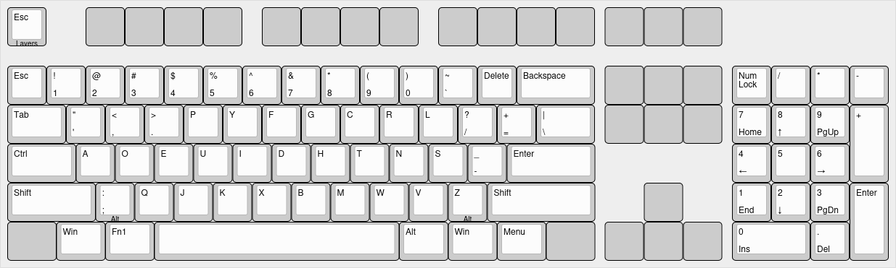
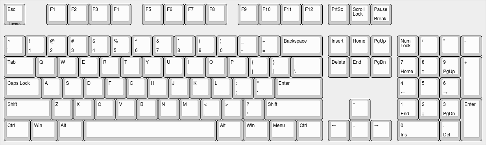
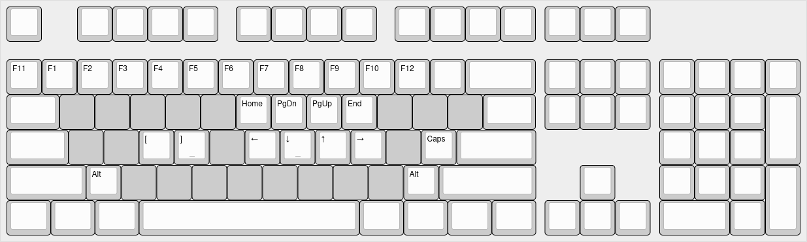
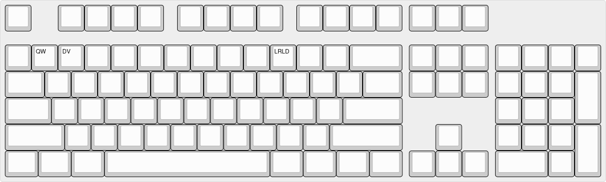

# Kanata
## Why Use Kanata
I wanted to use standard keyboards with a keymap similar to my Lily58 layout, which has layers and a different alpha layout.

## Layers
### Base Layer

<a href="https://www.keyboard-layout-editor.com/##@_radii=0px%3B&@=Esc%0A%0A%0A%0ALayers&_x:1&g:true%3B&=F1&=F2&=F3&=F4&_x:0.5%3B&=F5&=F6&=F7&=F8&_x:0.5%3B&=F9&=F10&=F11&=F12&_x:0.25%3B&=PrtSc&=Scroll%20Lock&=Pause%0ABreak%3B&@_y:0.5&g:false%3B&=Esc&=!%0A1&=%2F@%0A2&=%23%0A3&=$%0A4&=%25%0A5&=^%0A6&=%2F&%0A7&=*%0A8&=(%0A9&=)%0A0&=~%0A%60&=Delete&_w:2%3B&=Backspace&_x:0.25&g:true%3B&=Insert&=Home&=PgUp&_x:0.25&g:false%3B&=Num%20Lock&=%2F%2F&=*&=-%3B&@_w:1.5%3B&=Tab&=%22%0A'&=%3C%0A,&=%3E%0A.&=P&=Y&=F&=G&=C&=R&=L&=%3F%0A%2F%2F&=+%0A%2F=&_w:1.5%3B&=|%0A\&_x:0.25&g:true%3B&=Delete&=End&=PgDn&_x:0.25&g:false%3B&=7%0AHome&=8%0A%E2%86%91&=9%0APgUp&_h:2%3B&=+%3B&@_w:1.75%3B&=Ctrl&=A&=O&=E&=U&=I&=D&=H&=T&=N&=S&=%2F_%0A-&_w:2.25%3B&=Enter&_x:3.5%3B&=4%0A%E2%86%90&=5&=6%0A%E2%86%92%3B&@_w:2.25%3B&=Shift&=%2F:%0A%2F%3B%0A%0A%0AAlt&=Q&=J&=K&=X&=B&=M&=W&=V&=Z%0A%0A%0A%0AAlt&_w:2.75%3B&=Shift&_x:1.25&g:true%3B&=%E2%86%91&_x:1.25&g:false%3B&=1%0AEnd&=2%0A%E2%86%93&=3%0APgDn&_h:2%3B&=Enter%3B&@_g:true&w:1.25%3B&=Ctrl&_g:false&w:1.25%3B&=Win&_w:1.25%3B&=Alt&_a:7&w:6.25%3B&=&_a:4&w:1.25%3B&=Alt&_w:1.25%3B&=Win&_w:1.25%3B&=Menu&_g:true&w:1.25%3B&=Ctrl&_x:0.25%3B&=%E2%86%90&=%E2%86%93&=%E2%86%92&_x:0.25&g:false&w:2%3B&=0%0AIns&=.%0ADel"> Keyboard Layout Editor (Base Layer)
</a>
The base layer is in Dvorak, which is my main alpha layout for now. The left <code>Alt</code> key is replaced with a layer key, <code>Caps Lock</code> is replaced with <code>Control</code>, and the <code>;</code> and <code>Z</code> keys are tap-hold modifiers for <code>Alt</code>. Some symbols are also placed differently than in the default Dvorak layout. Most other keys in the standard layout are no-op keys. The number pad is not modified because <code>Num Lock</code> wasn't working last time I tried setting it to a different key. This is so I can use alt codes in Windows.

### QWERTY Layer
<a href="https://www.keyboard-layout-editor.com/##@@=Esc%0A%0A%0A%0ALayers&_x:1%3B&=F1&=F2&=F3&=F4&_x:0.5%3B&=F5&=F6&=F7&=F8&_x:0.5%3B&=F9&=F10&=F11&=F12&_x:0.25%3B&=PrtSc&=Scroll%20Lock&=Pause%0ABreak%3B&@_y:0.5%3B&=~%0A%60&=!%0A1&=%2F@%0A2&=%23%0A3&=$%0A4&=%25%0A5&=^%0A6&=%2F&%0A7&=*%0A8&=(%0A9&=)%0A0&=%2F_%0A-&=+%0A%2F=&_w:2%3B&=Backspace&_x:0.25%3B&=Insert&=Home&=PgUp&_x:0.25%3B&=Num%20Lock&=%2F%2F&=*&=-%3B&@_w:1.5%3B&=Tab&=Q&=W&=E&=R&=T&=Y&=U&=I&=O&=P&={%0A[&=}%0A]&_w:1.5%3B&=|%0A\&_x:0.25%3B&=Delete&=End&=PgDn&_x:0.25%3B&=7%0AHome&=8%0A%E2%86%91&=9%0APgUp&_h:2%3B&=+%3B&@_w:1.75%3B&=Caps%20Lock&=A&=S&=D&=F&=G&=H&=J&=K&=L&=%2F:%0A%2F%3B&=%22%0A'&_w:2.25%3B&=Enter&_x:3.5%3B&=4%0A%E2%86%90&=5&=6%0A%E2%86%92%3B&@_w:2.25%3B&=Shift&=Z&=X&=C&=V&=B&=N&=M&=%3C%0A,&=%3E%0A.&=%3F%0A%2F%2F&_w:2.75%3B&=Shift&_x:1.25%3B&=%E2%86%91&_x:1.25%3B&=1%0AEnd&=2%0A%E2%86%93&=3%0APgDn&_h:2%3B&=Enter%3B&@_w:1.25%3B&=Ctrl&_w:1.25%3B&=Win&_w:1.25%3B&=Alt&_a:7&w:6.25%3B&=&_a:4&w:1.25%3B&=Alt&_w:1.25%3B&=Win&_w:1.25%3B&=Menu&_w:1.25%3B&=Ctrl&_x:0.25%3B&=%E2%86%90&=%E2%86%93&=%E2%86%92&_x:0.25&w:2%3B&=0%0AIns&=.%0ADel">
    
</a>
Notice all keys except for escape are mapped back to the standard layout. This layer is in case I allow anyone else to use my keyboard.

### Fn1 Layer
<a href="https://www.keyboard-layout-editor.com/##@_radii=0px%3B&@_a:7%3B&=&_x:1%3B&=&=&=&=&_x:0.5%3B&=&=&=&=&_x:0.5%3B&=&=&=&=&_x:0.25%3B&=&=&=%3B&@_y:0.5&a:4%3B&=F11&=F1&=F2&=F3&=F4&=F5&=F6&=F7&=F8&=F9&=F10&=F12&_a:7%3B&=&_w:2%3B&=&_x:0.25%3B&=&=&=&_x:0.25%3B&=&=&=&=%3B&@_w:1.5%3B&=&_g:true&a:4%3B&=%22%0A'&=%3C%0A,&=%3E%0A.&=P&=Y&_g:false%3B&=Home&=PgDn&=PgUp&=End&_g:true%3B&=L&=%3F%0A%2F%2F&=+%0A%2F=&_g:false&a:7&w:1.5%3B&=&_x:0.25%3B&=&=&=&_x:0.25%3B&=&=&=&_h:2%3B&=%3B&@_w:1.75%3B&=&_g:true&a:4%3B&=A&=O&_g:false%3B&=[&_n:true%3B&=]&_g:true%3B&=I&_g:false%3B&=%E2%86%90&_n:true%3B&=%E2%86%93&=%E2%86%91&=%E2%86%92&_g:true%3B&=S&_g:false%3B&=Caps&_a:7&w:2.25%3B&=&_x:3.5%3B&=&=&=%3B&@_w:2.25%3B&=&_a:4%3B&=Alt&_g:true%3B&=Q&=J&=K&=X&=B&=M&=W&=V&_g:false%3B&=Alt&_a:7&w:2.75%3B&=&_x:1.25%3B&=&_x:1.25%3B&=&=&=&_h:2%3B&=%3B&@_w:1.25%3B&=&_w:1.25%3B&=&_w:1.25%3B&=&_w:6.25%3B&=&_w:1.25%3B&=&_w:1.25%3B&=&_w:1.25%3B&=&_w:1.25%3B&=&_x:0.25%3B&=&=&=&_x:0.25&w:2%3B&=&=">
    
</a>
The Fn1 layer has arrow keys in the home row and other navigation keys in the top row. <code>[</code> and <code>]</code> are in the home row as well. The function keys are placed in the number row.

### Layers Layer
<a href="https://www.keyboard-layout-editor.com/##@@_a:7%3B&=&_x:1%3B&=&=&=&=&_x:0.5%3B&=&=&=&=&_x:0.5%3B&=&=&=&=&_x:0.25%3B&=&=&=%3B&@_y:0.5%3B&=&_a:4%3B&=QW&=DV&_a:7%3B&=&=&=&=&=&=&=&_a:4%3B&=LRLD&_a:7%3B&=&=&_w:2%3B&=&_x:0.25%3B&=&=&=&_x:0.25%3B&=&=&=&=%3B&@_w:1.5%3B&=&=&=&=&=&=&=&=&=&=&=&=&=&_w:1.5%3B&=&_x:0.25%3B&=&=&=&_x:0.25%3B&=&=&=&_h:2%3B&=%3B&@_w:1.75%3B&=&=&=&=&=&=&=&=&=&=&=&=&_w:2.25%3B&=&_x:3.5%3B&=&=&=%3B&@_w:2.25%3B&=&=&=&=&=&=&=&=&=&=&=&_w:2.75%3B&=&_x:1.25%3B&=&_x:1.25%3B&=&=&=&_h:2%3B&=%3B&@_w:1.25%3B&=&_w:1.25%3B&=&_w:1.25%3B&=&_w:6.25%3B&=&_w:1.25%3B&=&_w:1.25%3B&=&_w:1.25%3B&=&_w:1.25%3B&=&_x:0.25%3B&=&=&=&_x:0.25&w:2%3B&=&=">
    
</a>
<code>Esc-1</code> goes to QWERTY, in case I allow anyone else to use my keyboard. <code>Esc-2</code> goes to Dvorak. <code>Esc-0</code> is a live reload for when I modify my keymap.
